# QoL-Artemis

Quality-of-life firmware for the **CircuitMess NASA Artemis Watch 2.0**, built for **iPhone** users.

It keeps everything the stock firmware does — the nine themes, the games, notifications,
media controls — and fixes the things that made it frustrating to wear every day: the
phone link that kept dropping (or looked connected but delivered nothing), random
restarts, a clock you had to set by hand, and missing basics like a stopwatch, alarms,
weather and world time.

<p align="center">
  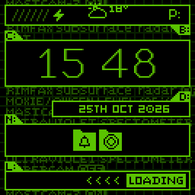
  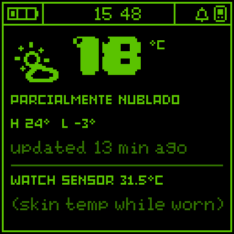
  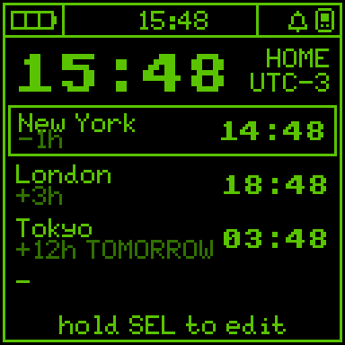
</p>

## What's new

### Reliability
- **iPhone link that stays up and comes back.** The stock firmware could end up "connected"
  in iOS while the watch never received notifications: when the iPhone negotiated the
  connection's MTU first, the watch's own request was never answered and service discovery
  stalled behind it. Fixed, along with an event-ordering race in encryption setup, an endless
  connection-parameter retry loop, and slow reconnects (the watch advertised at the slowest
  rate Apple allows whenever the screen was off). It now reconnects in a few seconds.
- **Sturdier low-power link.** Screen-off connection parameters (within Apple's rules) give
  the link ~3× more chances to recover from your body blocking the signal before it drops.
- **Notifications survive disconnects** instead of being wiped, and when the iPhone re-sends
  them on reconnect they don't all beep again. Only genuinely new notifications alert you.
- **No more crashes after a few hours on the wrist.** The stock event system leaked a little
  memory every time a listener's queue was full; with the screen off, battery updates queued
  up for a listener that can't run until the screen wakes, so a few hours of sleep used up
  the internal RAM — notifications stopped arriving, then the watch crashed.
- **No more random reboots/shutdowns.** The Bluetooth host task had 128 bytes of stack left
  (and a UI input task 156) — one deep call and the watch rebooted. A single bad battery
  reading right after waking could power the watch off; it's now filtered and confirmed.
- **Crash diagnostics.** Core dumps, reset history and Bluetooth link stats are recorded
  (see *System info*), so if something does go wrong it can actually be tracked down.

### Features
- **Time & date sync from the iPhone**, including your time zone and daylight saving time.
- **Weather on the watch face** (all nine themes) and a **Weather app** — from your iPhone's
  own Weather data, no Wi-Fi needed on the watch (see [Weather setup](#weather-setup)).
- **Temperature sensor**: the Weather app shows the watch's built-in sensor reading.
- **World clock** with four cities of your choice, DST-correct (rules verified against the
  IANA time zone database).
- **Stopwatch** with laps, **timer**, and **3 alarms** (once / daily / weekdays / weekends,
  snooze). They keep running with the screen off and wake the watch when they ring.
- **Incoming calls wake the watch** — from sleep or from any app — and ring with the
  *Space Harrier* theme from the Japanese Sega Master System / Mark III BIOS until you
  answer, ignore or reject. (The stock firmware only reacted with the screen on, and just
  blinked the LEDs.)
- **Quiet hours**: turn the switch on in Settings and set *Quiet from* / *Quiet until*; in that
  window notifications don't beep or blink. Calls and alarms still ring.
- Optional **phone-lost alert**: beeps if the phone stays out of reach for a minute.
- **System info**: battery, phone link, drops, crashes, time zone.

### Battery
Battery life matters more than features on a watch, so the additions are event-driven and
idle when the screen is off: no Wi-Fi radio, the gyroscope is powered down during sleep, and
a stock loop that woke the CPU every second all day now runs every 15 s.

<p align="center">
  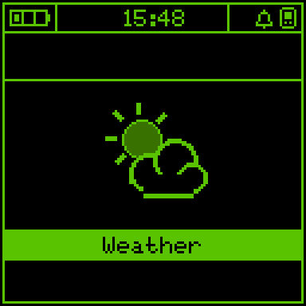
  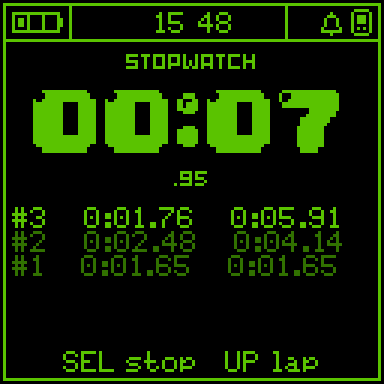
  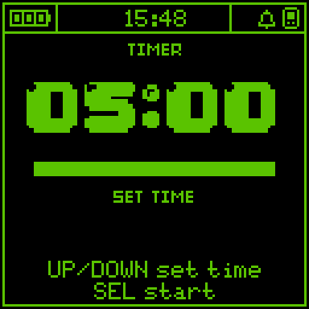
  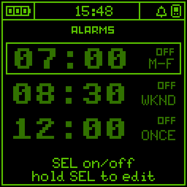
  <br>
  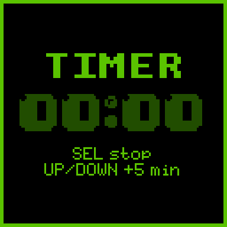
  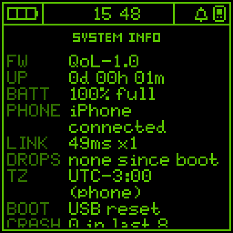
  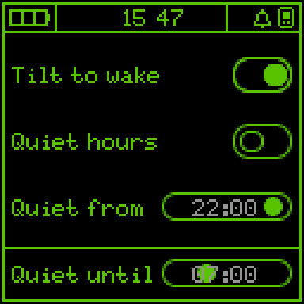
</p>

Weather on all nine themes:

<p align="center">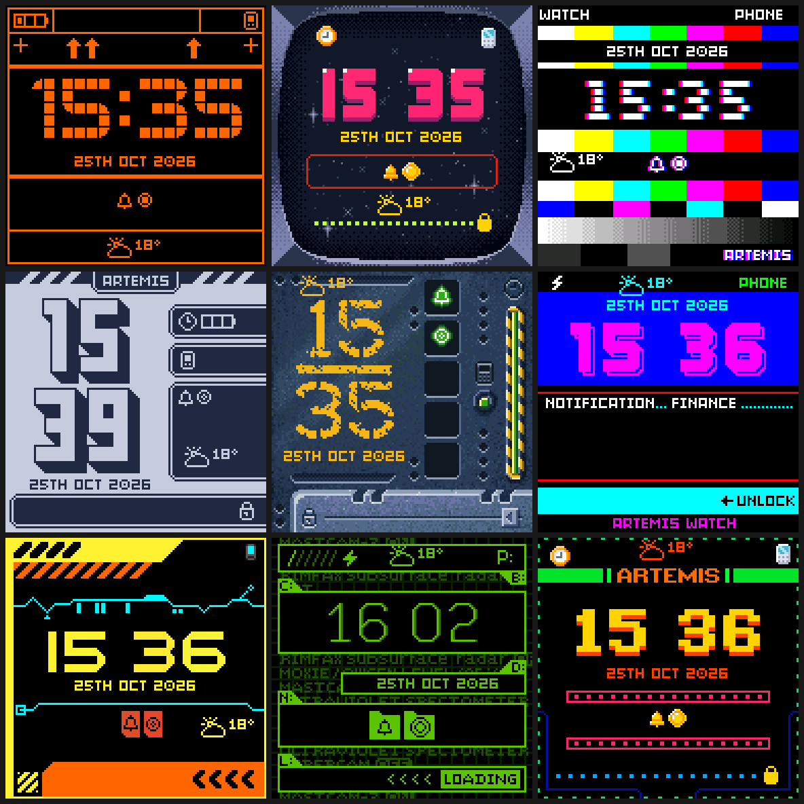</p>

## Install

1. Download the files from the [latest release](../../releases/latest).
2. Connect the watch over USB and flash it with [esptool](https://github.com/espressif/esptool)
   (`pip install esptool`), replacing `PORT` with the watch's port (e.g. `/dev/cu.usbmodem1101`
   on macOS, `COM5` on Windows):

   ```shell
   esptool.py --chip esp32s3 -p PORT -b 921600 write_flash \
     0x0 bootloader.bin 0x8000 partition-table.bin 0x10000 Artemis-Firmware.bin 0x2f6000 storage.bin
   ```

   This keeps your settings and the Bluetooth pairing with your iPhone.

To go back to the stock firmware, use **Restore Firmware** on
[code.circuitmess.com](https://code.circuitmess.com/) or flash the image from the
[CircuitMess releases](https://github.com/CircuitMess/GC_Artemis-Firmware/releases).

If notifications don't show up after installing, open **Settings → Bluetooth** on the
iPhone, *Forget* the Artemis Watch and pair it again (allow *Share System Notifications*).

## Weather setup

iOS doesn't give Bluetooth accessories access to weather, so a small **iPhone Shortcut**
fetches it and passes it to the watch as a notification. The watch reads it, updates the
weather, and clears the notification from your iPhone — you never see it.

**1. Create the shortcut** (Shortcuts app → **+**), name it *Artemis Weather*:

1. Add **Get Current Weather** (current location).
2. Add **Show Notification**. Leave the title as it is; set the body to the *Weather
   Conditions* variable four times, separated by `|`, choosing a different detail each time
   (tap the variable → pick the detail):

   `Temperature|Condition|High|Low`

   When it runs, the notification text looks like `24°C|Cloudy|24°C|8°C`. Any language
   and °C or °F work; the temperature has to come first.
3. Run it once and allow the location / notification permissions.

The watch recognizes these notifications (from the Shortcuts app, in that format), shows the
weather and clears them from the iPhone.

**2. Run it automatically** (Shortcuts → **Automation** → **+** → **Time of Day**): pick a
time, *Repeat: Daily*, choose **Run Immediately**, and select *Artemis Weather*. Add a few
of these spread over the day (e.g. 7:00, 10:00, 13:00, 16:00, 19:00). Weather older than
6 hours is hidden from the watch face.

**Optional:** in **Settings → Notifications → Shortcuts**, turn off *Sounds* and *Banners*
so the updates are completely invisible on the iPhone (keep *Notification Center* on — that's
what the watch receives).

If the watch is out of range when the shortcut runs, it picks up the latest update when it
reconnects.

## Using the apps

| Button | Stopwatch | Timer | Alarms | World clock |
|---|---|---|---|---|
| **Select** | start / stop | start / pause (hold: reset) | on / off (hold: edit) | (hold: edit city) |
| **Up** | lap | add time | previous | previous |
| **Down** | reset (when stopped) | remove time | next | next |
| **Back** (side) | back to menu | | | |

When an alarm or the timer rings: **Select** stops it, **Up/Down** snoozes 5 minutes.
New settings are in **Settings**: quiet hours, phone-lost alert, weather on face.

## Building from source

The firmware is an ESP-IDF project, built with the same pinned IDF as the stock firmware:
IDF commit [3a45d4e](https://github.com/espressif/esp-idf/tree/3a45d4e949a174e8829a2e4c86c421b030ceac5a)
with [ESP-IDF.patch](ESP-IDF.patch) applied (FPU context-switch fix).

```shell
git clone --recursive https://github.com/Dyotson/QoL-Artemis.git
cd QoL-Artemis
(cd components/JPEGDEC && git apply ../../JPEGDEC.patch)
(cd components/LovyanGFX && git apply ../../LovyanGFX.patch)
idf.py build
idf.py -p PORT flash
```

Use Python 3.12 or older for this IDF version.

### Tools

- `tools/watch.py` — talks to the watch's USB dev console: `watch.py cmd help`,
  `watch.py shot out.png` (screenshot), `watch.py cmd diag` (reset history, link stats),
  `watch.py cmd wx 18 C|Clear|20 C|10 C` (test a weather update), `watch.py cmd call`
  (simulate an incoming call), `watch.py cmd notifs` (list notifications).
- `tools/gen_icons.py` — menu icons for every theme, in each theme's palette.
- `tools/gen_weather_icons.py` — weather icons and the degree-sign font.
- `tools/gen_ringtone.py` — renders the ringtone from a MIDI file into chirp data.
- `tools/lvimg.py` — LVGL image (`.bin`) ⇄ PNG converter.

## Credits

- Original firmware, hardware and themes by [CircuitMess](https://github.com/CircuitMess/GC_Artemis-Firmware).
  This is an unofficial community firmware, not affiliated with CircuitMess or NASA.
- Ringtone: *Space Harrier* theme by Hiroshi Miyauchi (SEGA), as arranged in the Japanese Sega
  Master System BIOS; note data derived from the MIDI sequence by João "Johnnyz" Buaes on
  [VGMusic](https://www.vgmusic.com/music/console/sega/master/).
